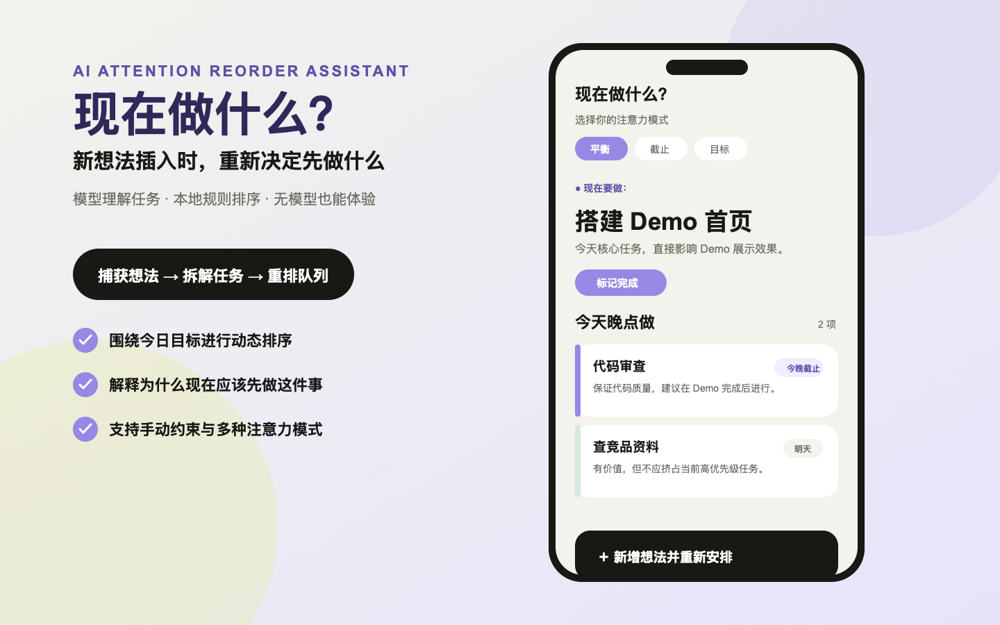

# 现在做什么？ · AI 注意力重排助手

> 新想法插入时，不是继续堆积待办，而是重新分配今天的注意力。

An AI-assisted daily queue that answers “what should I do now?” when new tasks interrupt the day.

[](https://github.com/chenxinyu23/what-to-do-now/actions/workflows/ci.yml)
[](LICENSE)
[](package.json)



## 项目简介

「现在做什么？」是一个移动端优先的今日队列 Demo。用户可以输入临时出现的新想法，系统会先将其拆解为任务，再结合今日目标、截止时间、阻塞风险、任务价值、耗时与精力匹配度，重新生成：

- **现在做**：当前最值得集中注意力的事项。
- **今天晚点做**：今天仍应推进，但不需要立刻处理。
- **不放进今天**：有价值但暂时不应占用今天注意力的事项。

模型只负责理解和补全任务维度，最终排序由本地规则引擎完成。用户可以在页面中接入自己的 OpenAI-compatible API 和 Key；未配置、超时或输出不合法时，服务会自动切换到备用规则，保证 Demo 仍可体验。

## 核心能力

- 将一句中文输入拆成多个可执行事项。
- 围绕今日目标重新排序，而不是简单追加任务。
- 提供平衡、截止优先、目标优先和低负担优先模式。
- 支持手动排序、移出今天、标记完成和撤销操作。
- 展示排序原因、队列变化和被打破的手动约束。
- 使用浏览器 `localStorage` 保存本地体验状态。
- 支持用户在浏览器中配置自己的 DeepSeek、Qwen、OpenAI 等 Chat Completions 风格接口。

## 工作原理

```text
用户输入
   │
   ▼
Express API ──► OpenAI-compatible 模型
   │                  │
   │                  └─ 抽取任务与评分维度
   │
   ├─ 模型失败 ──► 本地备用抽取器
   │
   ▼
Schema 归一化 ──► 本地评分与约束引擎 ──► 可解释的今日队列
```

后端代理负责限制请求体大小、校验用户模型配置并执行权威排序；浏览器只访问本项目的 `/api/reorder` 接口。

## 快速开始

### 环境要求

- Node.js 22 或更高版本
- npm 10 或更高版本

### 启动项目

```bash
npm ci
cp .env.example .env
npm run dev
```

打开 `http://localhost:3000`。

没有模型 API Key 也可以运行。此时 `/api/reorder` 会返回 `source: "fallback"`，并使用本地备用规则完成体验。

### 推荐体验路径

1. 查看顶部的今日目标和当前首要任务。
2. 点击底部的“新增想法”。
3. 选择“Demo 提交”示例，或输入：`刚想到还要录制 1 分钟演示视频、检查线上链接、补一版项目说明`。
4. 点击“新增并重排”。
5. 如需真实模型分析，展开“大模型 API”，填写自己的 Base URL、模型名和 API Key 后保存。
6. 查看今日队列变化与 AI 取舍解释。

## 用户模型配置

模型配置在页面中的“大模型 API”折叠区完成，并保存在当前浏览器的 `localStorage`。完整填写后，每次重排都会随 `/api/reorder` 请求发送到本地后端，由后端代理调用你配置的模型服务。

| 页面字段 | 默认值 | 说明 |
| --- | --- | --- |
| Base URL | `https://api.deepseek.com` | OpenAI-compatible API 根地址 |
| 模型名 | `deepseek-chat` | 具体模型名称 |
| API Key | 空 | 用户自己的模型 API Key；为空时使用备用规则 |
| 超时时间 | `5000` | 模型请求超时时间，单位为毫秒 |

DeepSeek 示例：

```text
Base URL: https://api.deepseek.com
模型名: deepseek-chat
```

Qwen Plus 示例：

```text
Base URL: https://dashscope.aliyuncs.com/compatible-mode/v1
模型名: qwen-plus
```

OpenAI 示例：

```text
Base URL: https://api.openai.com/v1
模型名: gpt-4o-mini
```

模型地址必须使用 `https://`；本地开发时允许 `http://localhost` 和 `http://127.0.0.1`。第一阶段不提供自动模型路由。

`.env.example` 只用于服务端监听地址和端口，不再保存模型 API Key。

## API

```text
GET  /
GET  /assets/*
POST /api/reorder
POST /api/model/test
```

`POST /api/reorder` 接收新增输入、当前队列、手动约束、排序模式和可选的用户 `modelConfig`，返回抽取任务、今日队列、移出今日任务、变化事件与解释信息。

`POST /api/model/test` 接收用户 `modelConfig` 并发起一次轻量模型调用，用于确认 Base URL、模型名和 API Key 是否真实可用。保存配置不等于连接成功，页面会显示 `未配置`、`未测试`、`测试中`、`已连接` 或 `连接失败`。

## 常用命令

```bash
npm run dev                         # 启动前端与 API 服务
npm run check                       # 检查关键 JavaScript 文件语法
npm test                            # 运行规则与 HTTP 测试
npm run eval:model                  # 运行模型评测集
npm run eval:model -- --strict      # 将评测 CHECK 作为失败处理
```

模型评测会读取 `evals/task-analysis-cases.json`，并将本地结果写入被 Git 忽略的 `evals/results/` 目录。需要评测真实模型时，可临时设置 `MODEL_BASE_URL`、`MODEL_NAME` 和 `MODEL_API_KEY`；这些变量不会作为应用默认 Key。

## 设计文档

- [产品需求文档](PRD.md)：产品定位、用户流程、状态和验收标准。
- [技术架构文档](TECH_ARCH.md)：前后端边界、数据结构、排序策略和演进方案。

## 隐私与安全

- 不要提交 `.env` 或任何真实 API Key；仓库只保留 `.env.example`。
- 用户队列和用户填写的模型配置默认保存在当前浏览器的 `localStorage` 中。
- 启用模型时，任务输入和 API Key 会发送到本地后端，任务输入会继续发送到你配置的第三方模型服务，请遵守对应服务的隐私条款。
- 当前项目定位为本地 Demo，不包含公网生产环境所需的鉴权、限流、持久化和监控。

## 当前限制

- 仅实现一个 OpenAI-compatible provider adapter。
- 语音输入依赖浏览器 Web Speech API 支持情况。
- 前端仍是单页原生 JavaScript 实现，后续可按状态、API 和渲染模块继续拆分。
- 排序策略用于产品原型验证，不应视为专业时间管理或决策建议。

## License

[MIT](LICENSE) © 2026 Chen Xinyu
